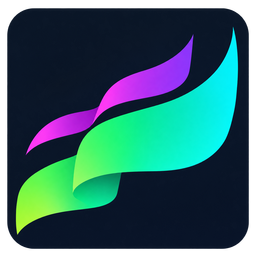

<p align="center">
  
</p>

<h1 align="center">Aurora Watch Panel</h1>

<p align="center">
  A self-hosted dashboard for aurora watching: space weather, solar imagery, local weather, astronomy and all-sky cameras.
</p>

<p align="center">
  <a href="https://aurora.slashmad.com">Live site</a> ·
  <a href="#quick-start">Quick start</a> ·
  <a href="https://github.com/slashmad/aurorawatchpanel/issues">Report a problem</a>
</p>

[](https://aurora.slashmad.com)
[](LICENSE)

Aurora Watch Panel is a self-hosted dashboard for aurora observations, space weather, solar imagery, local weather, astronomy, and all-sky cameras. It combines a FastAPI backend, a browser-based dashboard, MariaDB, NGINX, and independent collectors for external data feeds.

**Live view:** see it running at [aurora.slashmad.com](https://aurora.slashmad.com).

The project is created and maintained by [slashmad](https://github.com/slashmad).

## Features

- Solar-wind speed, density, magnetic-field components, and derived aurora indicators
- Kp and HP30 geomagnetic indices
- IRF, FMI, and global magnetometer series
- Location-aware weather with SMHI, FMI, MET Norway, and Open-Meteo fallback paths
- Sunrise, sunset, twilight, moon phase, astronomical objects, and ISS data
- NOAA/SWPC aurora oval, solar events, sunspots, ENLIL, LASCO, and CCOR imagery
- NASA/Helioviewer SDO imagery and local timelapse generation
- Coronal-hole detection and historical browsing
- Local and remote all-sky camera views
- Day replay combining imagery and time-series observations

## Architecture

```text
Browser
  -> NGINX
       -> static UI and generated media
       -> FastAPI API
            -> MariaDB

Collector containers
  -> external scientific and weather services
  -> MariaDB and local data directories
```

The browser application is plain HTML, CSS, and JavaScript modules. Charts use Highcharts and maps use Leaflet. Docker Compose runs the web tier, database, collectors, and renderers.

## Data sources

The application integrates public services and products from organizations including:

- NOAA Space Weather Prediction Center
- NASA/Helioviewer
- Swedish Institute of Space Physics (IRF)
- Finnish Meteorological Institute (FMI)
- Swedish Meteorological and Hydrological Institute (SMHI)
- MET Norway
- GFZ German Research Centre for Geosciences
- USGS geomagnetic services
- Open-Meteo

Availability, licensing, schemas, and usage conditions of external data remain the responsibility of their respective providers. This repository does not redistribute the fetched scientific datasets.

Bundled visual-asset attribution is recorded in [THIRD_PARTY_NOTICES.md](THIRD_PARTY_NOTICES.md).

## Requirements

- Docker Engine with Docker Compose v2
- Internet access for the selected collectors
- Sufficient persistent storage for MariaDB and generated imagery
- Optional local all-sky image directory

The SDO collectors can generate very large datasets. Define and monitor a retention policy before enabling long-running high-resolution backfills.

## Quick start

1. Clone the repository:

   ```bash
   git clone https://github.com/slashmad/aurorawatchpanel.git
   cd aurorawatchpanel
   ```

2. Create the private environment file:

   ```bash
   cp .env.example .env
   ```

3. Replace every `change-me` value in `.env`. Use strong, unique database passwords and set `WEATHER_USER_AGENT` to an identifiable value accepted by upstream weather services.

4. Create the local data directories if they do not already exist:

   ```bash
   mkdir -p app/data/images app/data/noaa_anim app/data/suvi-timelapse app/data/huxt app/data/tmp mariadb_data
   ```

5. Validate and start the stack:

   ```bash
   docker compose config
   docker compose up --build -d
   ```

6. Build the frontend bundle. `app/static/js/main.min.js` is generated and not tracked by Git, so this is required after every checkout or frontend change:

   ```bash
   docker exec aurora-watch-backend esbuild static/js/main.js --bundle --format=esm --minify --outfile=static/js/main.min.js
   ```

7. Open `http://localhost:32230/`.

The FastAPI service is exposed on port `32231`; MariaDB is exposed on `3306`. Restrict or remove those host bindings when they should not be reachable outside the Docker host.

## Configuration

Configuration belongs in `.env`, which is intentionally ignored by Git. See [.env.example](.env.example) for the supported baseline variables.

Important values include:

| Variable | Purpose |
|---|---|
| `MARIADB_*` | Database initialization values |
| `DB_HOST`, `DB_PORT`, `DB_USER`, `DB_PASS`, `DB_NAME` | Backend and collector database connection |
| `TZ` | Container timezone |
| `WEATHER_USER_AGENT` | Contact-capable user agent for upstream weather APIs |
| `ALLSKY_IMAGES_PATH` | Host directory mounted read-only at `/allsky-images` |

Use `docker-compose.override.yml` for machine-specific mounts or service overrides. It is ignored by Git.

## Repository data policy

The repository contains source code and small static UI assets only. The following stay local and must not be committed:

- MariaDB data and database files
- Downloaded SDO, NOAA, all-sky, HUXt, and timelapse media
- Exports, temporary files, logs, and generated aurora-oval history
- `.env`, keys, certificates, credentials, and secret files
- Files matching `*.bak`, numbered `.bak` variants, and backup directories
- Editor state and historical local experiments

Backup and runtime files are not deleted by the project; Git and Docker simply exclude them.

## Development

The backend source and browser assets are mounted into the containers by Compose, so local changes are visible after the relevant process or container reload.

Useful checks:

```bash
docker compose config --services
.venv/bin/python -m pytest
.venv/bin/python -m coverage run -m pytest
.venv/bin/python -m coverage report
.venv/bin/python -m ruff check app
.venv/bin/python -m mypy app/test_images_list.py
npm run check:js
npm run test:browser
git diff --check
```

Install the reproducible development dependencies separately from production:

```bash
python3 -m venv .venv
.venv/bin/python -m pip install -r app/requirements.lock.txt -r app/requirements-dev.txt
npm ci
npx playwright install chromium
```

When a compatible system Chromium is already installed, the browser test can use it without downloading another browser:

```bash
PLAYWRIGHT_CHROMIUM_EXECUTABLE=/usr/bin/chromium-browser npm run test:browser
```

The default Ruff gate checks fatal parser and compiler-error classes across the existing application. Broader legacy lint and undefined-name cleanup is intentionally handled as separate, narrowly reviewed work. The similarly named `app/test_coronal_hole_mask.py` is an operational image-analysis script and is deliberately excluded from automatic pytest collection because importing it creates output directories.

The page loads `/static/js/main.min.js`, an esbuild bundle of `app/static/js/main.js` and its imports. It is a build artifact and is not committed. Outside Docker, build it with the pinned esbuild version (`npm run test:browser` does this automatically):

```bash
npm run build
```

## Security

Never commit `.env`, credentials, private keys, database contents, internal host paths, or production exports. If a secret is exposed, rotate it before removing it from Git history. Please report security issues privately to the maintainer instead of opening a public issue containing sensitive details.

## Contributing and forks

Issues, changes, and forks are welcome. Keep external-source integrations defensive: validate responses, preserve last-known-good data, and expose freshness or failure rather than silently replacing valid observations with empty state.

## Support

Like Aurora Watch Panel? Buy me a beer 🍺

[](https://github.com/sponsors/slashmad)
[](https://ko-fi.com/slashmad)
[](https://liberapay.com/slashmad/)

## License and attribution

This project is released under the [MIT License](LICENSE). You may use, fork, modify, merge, publish, and redistribute it. Copies and substantial portions must retain the copyright and license notice crediting [slashmad](https://github.com/slashmad).
